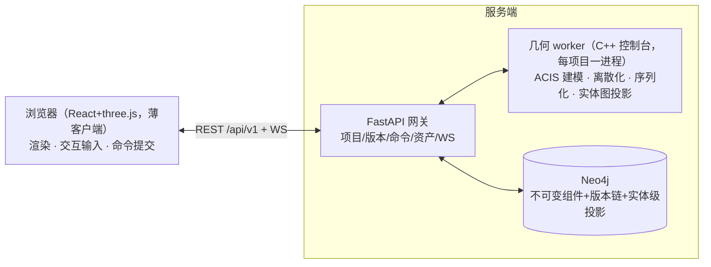
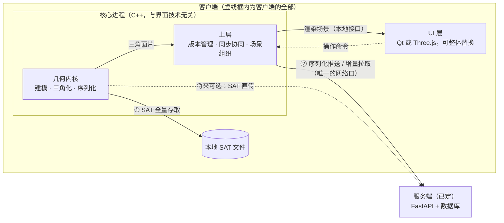

# DBCAD 架构定稿（v2，2026-10-18）

> 本文是当前有效的架构基准。旧的"代码组织与维护边界"版本见 git 历史（`legacy/pre-architecture-v2` 及更早）。
> **v3 架构决策已定（2026-10-18）**：几何内核迁至服务端 worker、服务端权威命令执行、浏览器薄客户端、旧 API 废弃——**§0 为决策层，与 §1-6（v2 已实现基准）不一致处以 §0 为准**。完整计划与决策记录（ADR-1 内核位置、ADR-2 并发模型）见 [V3_PLAN.md](V3_PLAN.md)。

## 0. v3 决策层（已定，实施中——本节优先于下文 v2 表述）

- **内核位置（ADR-1）**：ACIS 随 worker 进入服务端；FastAPI 本身仍是 Python、不直接加载内核，但**"服务端不含几何计算"的旧边界作废**——几何命令在 worker 的权威状态上执行（服务端权威，Onshape 模式），客户端只提交命令与渲染网格。
- **并发模型（ADR-2）**：ACIS 单进程不支持并发建模；跨项目=进程隔离，同项目=串行命令队列（命令全序=版本链）。
- **实体级图存储的去留与形态（ADR-3，2026-10-19 决定，P6 已实施）**：**保留，以投影层形态前移进 v3（P6 已落地）**——SAT+版本清单是唯一权威，实体级图是 worker 在组件发射管线里产出的可查询投影（挂不可变组件之下，物理表示沿用 Phase B"细"档：原生标签+一级扁平字段+`:Unknown` 显式兜底）。第一版投影不需要稳定 uuid：组件内容寻址、不可变，投影随组件幂等生成；跨版本实体追踪（拓扑命名的变体）推迟到 P8 用内容寻址/generation 链解决。实体图序列化器已去 Qt 化搬入 worker（`worker/entity_graph_codec`，uvsafe-topology-v5-bounded codec 逐 case 保真），**不随 P7 旧物拆除删除**；`entity_graph_deserializer` 随 v2 退役（v3 组件恢复走 SAT restore，不需要 JSON 反序列化）。
- **旧协议废弃**：json-delta 推拉与旧 WS 通知废弃，换 API v1（契约先行）；Qt 客户端先冻结后删除。
- v2 的三条设计不变量（§3）在 v3 下继续成立，其中"UI 与 AI 都是核心的客户端"升格为"UI/AI/任何命令提交者都是 worker 的平级客户端"。

## 1. 总图（v2，已实现）

一句话（v2）：**客户端就两个部件——核心进程 + UI**。核心进程对内包着几何内核，对外只有两个口子（本地文件口、网络口）；UI 只跟核心打交道，可整体替换。（v3 起"核心进程"以 worker 形态迁至服务端，见 §0。）

## 2. 部件职责

| 部件 | 职责 | 边界 |
|---|---|---|
| 几何内核 | 建模、三角化（供渲染的网格）、序列化（内存模型 ↔ 传输 JSON 的唯一翻译） | 全程序唯一触碰 ACIS 的地方；输出全是中立数据（句柄、坐标、JSON），不含 SDK 类型 |
| 上层 | 版本管理、推送/拉取同步、协同冲突处置、把三角面片组织成可渲染场景 | 核心进程的一部分，无界面依赖；网络只在此处出现 |
| UI 层 | 显示与输入，别的什么都不干 | 只消费纯渲染数据（坐标/索引/颜色）和发操作命令；现在是 Qt，将来可换 Three.js 等，换 UI 不动核心 |
| 服务端 | FastAPI（版本管理、冲突检查、协同广播）+ 数据库（现为 Neo4j 图库，可换关系库） | v2：不加载几何内核，不解析 SAT；对客户端只有一个线协议。（v3 起：FastAPI 侧新增几何 worker 承载 ACIS，见 §0/ADR-1——FastAPI 自身仍不加载内核） |

## 3. 设计不变量（三条，定下来不再讨论）

1. **内核是唯一懂几何的地方**——建模、三角化、序列化都从这里出，别处不碰 ACIS。
2. **存储是可换的后端**——就两条链路：SAT 全量（本地文件，内核原生读写）；序列化 JSON（经上层同步到服务端入库）。将来 SAT 直传云端、图库换关系库，都是加一条后端实现，不动内核和上层。
3. **UI 与 AI 都是核心的"客户端"**——核心不关心对面是人、是界面还是 AI，只认"要场景数据"和"发操作"两种交互。AI 将来作为另一个操作者直接在上层命令入口发命令，与 UI 平级，不需要外挂协议。

## 4. 存储与线协议

- **两条存储链路**：SAT 全量本地存取（`access.cpp`，交换格式 + 测试正确性基准）；序列化 JSON 云端协作（客户端编码组件 → FastAPI 合并 → Neo4j 不可变组件 + 版本清单链）。SAT 片段作为组件属性随 JSON 走，服务端不解析。
- **线协议冻结**：`POST/GET /projects/{id}/json-delta`（base_version 乐观锁、组件级整替合并）与 WS 通知协议保持不变，两侧测试（后端 44 项无 DB 回归 + L3 真 Neo4j 往返）是保护网。换数据库、升级库内物理表示，都不动协议。
- **库内物理表示（Phase B 已实施，2026-10-18）**：`JsonGraphEntity` 双表示——权威载荷 labels_json/props_json（graph() 读投影，迁移前后逐字节等价）+ 原生 Neo4j 标签与一级扁平字段（可查询投影，如 `MATCH (f:Face) WHERE f.geometry_type='spline'`；未识别类型显式落 `:Unknown`，绝不静默）。存量迁移脚本幂等（`backend/scripts/migrate_json_graph_native_v2.py`）。
- **协同模型（M4.1–4.3 已实施）**：混合粒度不变；自动微版本同步 + 显式定版标签（`/json-delta/tags`）、变更通知到达即自动拉取（无冲突时；同组件并发仍诚实拒绝）、组件级编辑意图广播与软锁提示（edit_intent）。分支 DAG 与语义 diff 仍为路线图（REFACTOR_PLAN M4.4/4.5）。拓扑级自动合并不做（拓扑命名问题无解，业界同样不做）。
- **v3 存储模型与实体级投影（ADR-3，P6 已实施 2026-10-19）**：v1 侧库内为 `V1Project/V1Version/V1Component{hash_sat}` 三类节点，版本经 `CONTAINS` 引用不可变组件（内容寻址，SAT+GLB+graph 三资产、CDN 语义缓存）；组件之下挂 `HAS_ENTITY` 实体级投影节点（Face/Edge/… 原生标签+一级扁平字段，`:Unknown` 兜底），由 worker 序列化器产出、网关随组件入库写入（幂等：已有投影零写入）——服务端仍不反解析 SAT；拓扑关系为统一边型 `[:TOPOLOGY {rel_type}]`；查询端点 `GET /api/v1/projects/{id}/entities`。P8 实体级增量（组件内 diff + generation 回放 + 压实）恢复论文第 5 章语义，验收：改一个 face，新增实体节点数 ≈ 变更实体数。

## 5. 本轮清理记录（2026-10-18，refactor/architecture-v2）

删除（留档 tag：`legacy/pre-architecture-v2`）：

- **客户端 Bolt 直连 Neo4j 栈**：`storage/` 全部 12 文件、`neo4j.cpp/hxx`（mgclient 封装）、`kernel/legacy_storage.h`、`access.hxx`/`access.cpp` 中的 Neo4j 部分、`DbcadAPI` 兼容门面、内核里的 5000 圆柱打孔基准与直连诊断入口、对应菜单/模式/对话框/配置读取。
- **PostgreSQL 实验**：`pg_service`、`pg_store`、`ui/mainwindow_postgres.cpp`、部署脚本（with_pg/pgadmin/build_pg_demo）及构建依赖（libpq/openssl/glaze/mgclient 路径）。
- **死代码**：`entity_merge_engine`（零调用的三方合并引擎）；后端 `graph_diff`/`conflicting_ids`（未接线的旧冲突设计）与 `hasattr(store,"graph")` 不可达分支。
- **过时文档**：`技术路线指导.md`（bridge 时代架构，与现状冲突）。

保留的存取模式只剩两个：**SAT 文件（本地）** 与 **FastAPI（云端协作）**。

验证：客户端 Debug 编译通过（`x64/Debug/CAD_DB.exe`）；后端 `pytest -m 'not integration'` 43 项全绿。

## 6. 重建路线（2026-10-18 全部主里程碑完成）

> 执行计划、任务分解与各里程碑验收标准见 [REFACTOR_PLAN.md](REFACTOR_PLAN.md)。

1. **上层重建（M1/M2 已完成）**：协作编排已下沉 `CAD_DB/core/`（DocumentSession/CollabState/CollabController/CollabBackend/StorageBackend/CommandBus，仅 QtCore）；MainWindow/Qt 只剩壳；全部网络异步（无嵌套事件循环）。
2. **存储物理表示升级（M3/Phase B 已完成）**：原生标签 + 扁平字段 + 幂等迁移 + L3 结构断言；协议与客户端零改动。
3. **协同工作流（M4.1–4.3 已完成）**：自动拉取、在场感知（edit_intent 软锁提示）、定版标签；分支 DAG（M4.4）与语义 diff（M4.5）为后续路线图。
4. **AI native（M6 第一步已具备）**：CommandBus 提供名→schema→执行器的程序化命令入口（AI 与 UI 平级调用同一注册表）；审批流为后续工作。
5. **实体级增量（M5/Phase D）**：已提级进 v3——P6 全量投影 + P8 实体级增量（见下条第 6 点与 V3_PLAN.md），设计参照 STORAGE_CONSOLIDATION_PLAN。
6. **v3（P0–P5 已完成，剩余 P6–P8）**：新 API v1 + 服务端权威命令执行 + 工业级 Web 客户端；剩余 **P6 实体级图投影（ADR-3）→ P7 拆除 Qt 与旧协议（原 P6，范围收缩：序列化器先搬家进 worker）→ P8 实体级增量（Phase D，接管 M5）**。本条接管上文 M4.4/M4.5/M5/M6 的排序——M4.4 分支并入 v3 P2（协议预留）/P5（合并 UI），M5 提级为 P6/P8，M6 AI 入口随服务端 CommandBus 自然落地。见 [V3_PLAN.md](V3_PLAN.md)。

执行细节（命令记账、撤销栈、防回环、断线重连等）都属于上层内部实现，设计层面不在此展开。
