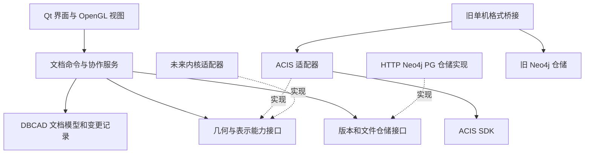

# DBCAD 几何内核隔离方案与测试计划

日期：2026-10-16。性质：代码阅读、架构设计与下一轮实施建议；本轮未修改实现。

## 1. 结论与阅读基线

建议实施隔离，采用“DBCAD 文档模型 + 内核能力接口 + ACIS 适配器”的结构。先把现有功能完整迁入边界，再讨论第二内核和通用几何交换格式。现有粗细混合序列化应保留为 ACIS 适配器的核心能力。

这次工作的完成标准应是：DBCAD 的文档、协作、界面和数据库业务不再依赖 ACIS 类型、指针、历史公告和枚举；ACIS 专用实现仍可完整工作。替换内核时实现同一组能力接口，并明确处理历史数据转换。不能把“套一层函数”直接等同于“任意内核随时无损互换”。

### 阅读范围和版本

- 实际源码根目录：`D:/THU_Things/DBCAD/current/DB-CAD-master/DB-CAD-master`。外层还有旧副本与备份，本报告以这个包含 `CAD_DB.sln` 的 Git 仓库为准。
- 当前分支：`fix/acis-kernel-isolation`；HEAD：`402136cf4620f3383282c4ae4ca3d79f6a6b18fb`，标题“统一存储协作链路并清理冗余代码”。阅读开始时工作树干净。
- 本地远端跟踪引用 `origin/fix/acis-kernel-isolation` 与 HEAD 相同；`origin/master` 为 `2f2c6f6334004239c0d07634d8c202870d308733`。相对该 master，当前分支多一个统一链路提交。用户描述的底层存储更新已在当前阅读基线中，不能再按旧 master 的整体架构推断。
- 尝试只读查询 GitHub 最新引用时，本机代理连接失败。因此以上远端比较基于本地跟踪引用，未确认 GitHub 当前实时状态；未 fetch、切分支、提交或推送。
- 核对了客户端构建清单、公开头文件、建模/交互、网格/拾取、历史、混合编解码、单机存储、Python 协作/存储和测试入口。SDK 本身与旧副本不作为本轮重构对象。
- 静态扫描：65 个受版本控制的客户端 `.cpp/.h/.hxx` 中，14 个直接包含 `acis/` 头文件。共享头还会向其他编译单元传播 SDK；46 个文件出现 ACIS 类型/符号字样，其中包含注释和字符串，后一个数字不能当作真实耦合文件数。

### 本轮验证

在 `CAD_DB/backend` 使用已有虚拟环境执行：

```powershell
.\.venv\Scripts\python.exe -m pytest -q -m 'not integration' -p no:cacheprovider
```

结果：**44 passed, 13 deselected**。13 项是被筛选排除的数据库集成测试，不能算通过。本轮没有重跑 ACIS C++ 编译/往返、真实数据库写入或双客户端 GUI。下文引用已有 C++ 测试时，仅说明已存在的测试代码及其覆盖意图，不冒充本轮运行结果。

## 2. 当前系统的真实边界

### 2.1 已经完成的混合链路应保留

当前唯一协作写入路径是：

```text
Window 实体树中的顶级实体及 UUID
  → serializeACISEntityGraph
  → JSON 拓扑/几何 + 每组件 SAT + fallback 策略
  → HTTP json-delta，附 base_version、changes、removed_ids
  → Neo4j 不可变组件及版本清单
  → HTTP Pull / 历史读取
  → 按 UUID 分组件恢复
  → 替换本地对应组件，保留无冲突的本地编辑
```

普通组件 `fallback=on_failure`：优先 JSON，失败才走 SAT。已知存在信息损失的组件 `fallback=sat_fragment`：直接走内核格式。每个顶级组件都附 SAT；SAT 写出失败会拒绝序列化。恢复批次中任一组件失败，不向 UI 返回部分成功的批次。相关实现见 `entity_graph_serializer.cpp:1205`、`:1330` 与 `entity_graph_deserializer.cpp:1231`。

这里的“细粒度”是几何/拓扑数据的表达粒度。当前协作冲突和替换单位仍主要是顶级 UUID 组件；子节点 ID 由指针地址生成，不是跨客户端稳定的面/边 ID。不能把这次隔离顺带解释成“已经支持同一实体不同面的无冲突并发编辑”。

### 2.2 JSON 共享了思路，但没有共用全部实现

`entity_graph_serializer.cpp`、`entity_graph_deserializer.cpp` 采用单机 access 的遍历和编码思路，但有自己的 JSON 编解码分支；`storage/access_*` 使用 `mg_value/mg_list` 和另外的恢复流程。检查调用后，不能认为两条路径已经共享同一套完整 codec 实现。

因此迁移时要保护两条路径各自的行为，后续在适配器内部逐步合并可复用的参数提取/重建逻辑。直接删除一套代码或强行让旧库格式等于当前 JSON 格式，都会扩大本轮风险。

### 2.3 后端已经没有 SDK 依赖，但仍有表示格式依赖

`backend/app/json_collab.py` 不运行 ACIS，也不解析 SAT；这一点很好。它仍识别 `body_lump`、`coedge_owner` 等拓扑关系，v2 校验要求顶级组件携带 `sat_fragment`。`json_graph_store.py` 通过这些规则拆分不可变组件。

换句话说：后端已与内核运行时分开，尚未与 ACIS 风格的数据协议完全分开。第一阶段保留 v1/v2 协议；未来引入表示描述与显式组件归属，才能让另一内核的格式被同一版本系统承载。

## 3. 耦合清单及处置方式

下表按职责覆盖当前主要源码入口；同组文件的全部 ACIS 专用实现均归入相应适配模块。直接 `include`、前向声明、`void*`、协议字面量及全局状态分别处理，不能只搜索 `#include`。

| 编号 | 现有位置与证据入口 | 耦合内容 | 分离后的归属与动作 |
|---|---|---|---|
| C01 | `acis.cpp:24`、`acis.hxx`；`mainwindow.cpp:50,139` | 初始化、许可、终止、`outcome` 错误处理由窗口触发；初始化级别返回值未被完整保存，关闭时固定传 2 | `AcisRuntime` 管理初始化级别、许可失败和逆序销毁。应用装配处创建运行时，窗口不调用 SDK |
| C02 | `mainwindow.h:10,70`；`ui/mainwindow_internal.h:62`；`window.h` / `glwidget.h` | 公共窗口头间接带入 `access.hxx`；共享 internal 头给几乎所有 UI 单元引入 SDK、mgclient；还有 ACIS 回调签名 | 公共头改用自有 DTO/接口；internal 头拆成职责明确的少量依赖。无调用者的声明经确认后清理，不扩展成公共 API |
| C03 | `window.h:27` 的 `ENTITY_TREE_ITEM`；`window.cpp:915` 附近 addEntity | UUID、名称、依赖、可见性与 `ENTITY*`、`SPAtransf`、`SPAposition`、网格裸指针混在一起 | 文档层拥有实体记录；自有 `Point3/Transform/EntityId`；内核对象只由适配器管理；视图缓存单独存放 |
| C04 | `window.cpp:343` `createEntity` | 体、面、边、样条、公式曲线直接调用 `api_*`，并处理输入模式、默认参数、占位 ENTITY | UI 负责输入过程和默认参数；适配器负责几何创建。未完成的样条是草稿，不用空 `ENTITY` 冒充几何 |
| C05 | `window.cpp:641` `operation`；`ui/mainwindow_menus.cpp` | 布尔、求交、去重；FACE/EDGE 转体；`BOOL_TYPE` 数值强转；同时删 UI 记录、隐藏对象和改选择 | DBCAD 操作枚举及命令进入应用层；几何转换/求交放适配器；输入是否消耗、结果个数和空结果显式返回；UI 菜单不使用 ACIS 的 UNION 等枚举 |
| C06 | `window.cpp:1038,1083,1126,1152` | 控制点重建、变换、颜色继承、下游依赖重算直接读写 ACIS 对象；重建可能替换指针 | 依赖图、控制点定义、重算顺序归文档/应用层；几何执行归适配器。返回真实变更集，统一失效网格和选择 |
| C07 | `ui/mainwindow_editing.cpp:109,162`；`gme_user_data.hxx:11` | UI 打开 bulletin board、note_state；`DELTA_STATE_user_data` 直接复制整个含指针的树条目 | 应用层命令事务与文档变更配对；ACIS history token 留适配器；历史载荷仅保存值数据、业务 ID、必要句柄映射，不保存 QWidget/显示缓存 |
| C08 | `ui/mainwindow_documents.cpp:102,146,166`；`window.cpp:283` | 撤销/重做直接 roll 历史，再通过 ACIS user_data 建树；`clear()` 同时删除实体和清空历史 | 区分清空视图、清空文档、重置内核历史。撤销需要同时恢复几何、文档记录、UUID 和协作变更集，不能只封装 roll 函数 |
| C09 | `window.cpp:268,283`；`ui/mainwindow_changes.cpp:54`；`ui/mainwindow_graph.cpp:6` | 关闭、清空、本地删除、远端替换各自删除 ENTITY；异常、结果状态和缓存失效的处理不同 | 适配器统一释放、失效与事务；应用层提交成功后统一变更文档。子拓扑是借用引用，不能按独立拥有对象随意删除 |
| C10 | `gme_mesh.hxx:17`；`gme_mesh.cpp:22,183,233,373` | 网格结构带 `FACE*/EDGE*/VERTEX*` 和 `rgb_color`；网格生成依赖 facet、owner transform、颜色属性及 NOP scope | `AcisTessellator` 生成自有 `MeshData`，包含普通颜色、顶点、索引、包围盒、owner ID 和短期选择标识；不向外泄漏拓扑指针 |
| C11 | `glwidget.cpp:355,647`；`glwidget.h` | 绘制高亮仍查 `api_get_owner`；拾取读顶点坐标和拓扑 bound；选中状态是 ENTITY 指针；paintGL 可触发模型修改 | 绘制仅消费 MeshData；近似拾取用网格标识与包围盒，必要时调用几何查询接口。交互命令在控制器执行；选择随组件 revision 失效 |
| C12 | `entity_graph_serializer.h:68`；`.cpp:463,470,1205` | 公共参数是 `ENTITY_LIST`；遍历 ACIS 拓扑、数学对象、过程子类、属性链，按指针生成节点 ID，直接写 SAT | 完整迁入 `AcisHybridCodec`，公共入口接收文档选出的实体引用。保留风险策略；外层只看可持久化的组件包 |
| C13 | `entity_graph_serializer.h` 的 `DeserializedEntityGraph`；`entity_graph_deserializer.cpp:519,1231` | `ENTITY_LIST*` 与 `QHash<QString,void*>` 传出所有权；三阶段骨架/几何/链接、pcurve 装配、SAT 回退和失败清理 | 私有三阶段逻辑保留；外层返回独占的 PreparedImport/暂存对象，只有成功提交后才进入文档；不用 void* 作为公共句柄 |
| C14 | `ui/mainwindow_json.cpp:4,108`；`ui/mainwindow_graph.cpp:6`；`ui/mainwindow_changes.cpp` | Push 从树捞指针；Pull 恢复后手工换指针、清缓存、释放旧实体；业务状态、几何操作、网络和 UI 互相穿插 | `CollaborationService` 调文档服务与 codec；版本冲突只处理 UUID 和修订；文档替换事务负责几何/记录一致性，UI 只响应事件 |
| C15 | `access.cpp:3,23,40,63,82,97`；`ui/mainwindow_save.cpp:67`、`load.cpp:3` | SAT 文件、history 文件、全局活跃实体枚举、FileInfo、保存版本及 FILE* 分散在 UI/access 中 | `AcisNativeCodec` 集中内存导入导出及选项；文件服务负责路径和字节 I/O。按文档显式指定导出集合，保留“默认历史流活跃集合”的兼容入口 |
| C16 | `storage/access_graph_save.cpp:3`、`access_graph_restore.cpp:3`；`access_parts.cpp` | 在遍历/创建 ACIS 实体时直接创建 mg 属性并执行 Cypher | 先用独立 legacy bridge 模块完整包住；随后拆成“ACIS↔旧格式 DTO”和“旧格式 DTO↔数据库”两部分，保留旧库 schema |
| C17 | `storage/access_save_values.cpp`、`access_restore_values.cpp`、`access_save_surfaces.cpp`、`access_save_curves.cpp`、两个 codec 头 | 数学/曲线/曲面编码直接返回 mg_list/Node；type/subtype、内部构造顺序与数据库格式绑定 | 参数提取与构造归 ACIS codec，mg 类型转换归旧格式仓储；先保持数据布局，再提取共用值对象 |
| C18 | `access.hxx:9`；`storage/access_history_save.cpp:3`、`access_history_restore.cpp:3` | 单机增量依赖 DELTA_STATE、BULLETIN、指针→数据库 ID；恢复会删除默认 history；保存端过滤部分类型 | 独立 `AcisLegacyHistoryBridge`，history 上下文与相应会话绑定。不是通用协作 delta；不能机械改写为现有组件 delta 后宣称语义不变 |
| C19 | `ui/mainwindow_postgres.cpp:69,140`；`pg_service.*`、`pg_store.*` | UI 直接导出/恢复 SAT，PG 服务本身只传字符串 | UI 调文档导入导出服务；PG 仓储继续不依赖内核。后续可增加格式元数据，旧 SAT 列保持兼容 |
| C20 | `gme_dump_object.hxx/.cpp`；`ui/mainwindow_documents.cpp:221,264,355,387` | 统计、dump、debug、菜单内测试直接操作 ACIS；部分测试连数据库 | 内核查询返回中立统计；原始内核 dump 是可选诊断能力。测试/基准从 UI 逐步独立成程序，不提升为业务接口 |
| C21 | `DbcadAPI.h/.cpp` | PIMPL 隐藏实现，但仍暴露 ENTITY_LIST 和含指针的 DisplayData；初始化还混入 mgclient；IncrementalContext 重复定义 | 用新的契约替代，旧 API 可做迁移期兼容门面。当前主 UI 未调用 ModelerSession，不能只改它便宣称项目完成隔离 |
| C22 | `backend/app/json_collab.py:27,129,144`；`json_graph_store.py:42`；`api/json_delta.py`；WebUI | 无 SDK，却有 SAT 字段名、ACIS 关系闭包和 body 根识别；客户端也独立维护组件判定 | v1/v2 兼容逻辑固定为旧协议 profile；新格式显式携带组件成员与关系角色，统一生成/验证契约。WebUI 将专用拓扑显示作为格式视图 |
| C23 | `CAD_DB.vcxproj:79`；构建、部署及 ACIS 测试 bat | 单一 exe 工程给所有源码 SDK include/lib、/MD、/EHa；运行库打包也识别 ACIS | 拆独立构建目标，适配器私有依赖 SDK；保留官方编译契约与运行时包要求。主 exe 栈大小和跨模块 CRT 不能因拆库自动取消 |

### 可以保留的已有边界

- `backend_api_client.*` 是 HTTP DTO/传输，没有真实 SDK 类型依赖。
- `collab_session.*` 是协作状态机，没有 ACIS 依赖；后续应从全局单例逐步转为文档/项目实例，不必先改状态语义。
- `neo4j.hxx/.cpp` 是 Bolt 连接层；`pg_service.*`、`pg_store.*` 是 PG 服务/仓储。它们不需要接受几何指针。
- `common.hxx/.cpp` 的计时、错误辅助基本中立。
- `entity_merge_engine.*` 没有 SDK 依赖，但搜索未发现当前主协作链调用其 merge 函数。它的旧 `props.sat` 平铺快照模型也不等于当前 `sat_fragment + rels` 组件图；不要直接复用成新的协作核心。
- `ui/mainwindow_connections/config/presence/messages/event_presence_ack/event_delta/collab_actions/actions/menus` 等多处并不需要执行内核操作；先去掉共享头污染。其中 menus 的布尔枚举和 actions 的专用提示需要单独适配。

## 4. 目标架构



依赖方向以接口所在的 DBCAD 契约层为中心：UI、应用、适配器都可以依赖契约；契约不依赖任何具体内核或数据库驱动。装配代码选择实现。初期采用编译时选择与构造注入即可，不必先做 DLL 动态插件发现、热切换或 RPC。

建议逐步形成：

```text
CAD_DB/
  core/                    # 文档记录、EntityId、依赖、变更日志
  application/             # 建模命令、导入替换、协作 Push/Pull
  kernel/contracts/        # 中立值对象、句柄、错误、能力接口
  kernel/acis/             # runtime、session、建模、history、网格、codec
  persistence/             # HTTP、文件、PG 及旧 Neo4j 仓储
  compatibility/acis_neo4j/ # 旧单机存储/历史桥接；迁移期明确的联合适配层
  ui/                      # Qt 界面与控制器
tests/
  architecture/            # 不允许的依赖、无 SDK 编译
  core/                    # 文档和协作逻辑
  contracts/               # 实现共同遵守的行为
  acis/                    # 真实几何、保真及历史
  integration/             # C++ + HTTP + 真数据库
```

目录只是建议，真实隔离由公开类型、依赖方向、所有权和构建目标保证。为保持步骤可审查，先建立接口和少量目标，再搬文件。

## 5. 接口与数据设计

### 5.1 三种身份必须区分

| 身份 | 用途 | 有效期 |
|---|---|---|
| `EntityId`（业务 UUID） | 文档顶级组件、协作冲突、版本追踪 | 跨进程、保存和恢复稳定；由 DBCAD 分配/维护 |
| `ShapeHandle` | 当前内核会话中的几何对象引用 | 仅当前 session；含 session 标识、槽位和 generation，防止旧句柄误命中新对象 |
| `SubshapeRef` / `SelectionRef` | 网格对应的面、边、顶点选择 | 通常仅当前组件 revision；重建/布尔/Pull 后失效，不假装是永久拓扑 ID |

现有 UI 的递增 index 可以短期保留为视图索引，不能再充当内核句柄或持久身份。指针→数据库 ID、指针→序列化临时 ID 的映射只能留在适配器或 legacy bridge 内。

适配器拥有 ACIS 实体及其拓扑生命周期，文档保存非拥有句柄。通用 `shared_ptr<ENTITY>`、`using Shape=ENTITY*`、公开 `void* nativeHandle()` 都会让生命周期与强转重新泄漏，不建议采用。需要兼容旧代码时，桥接函数应为内部接口，并设删除阶段。

### 5.2 需要的中立值对象

- `Point3`、`Vector3`、`Transform`、`Bounds3`、`ColorRGBA`；明确坐标单位、角度单位、矩阵布局和变换组合顺序。
- `ShapeKind`：实体/片体/线框/独立面/独立边/顶点等，避免系统只支持 Body。
- `PrimitiveSpec`、`CurveSpec`、`SurfaceSpec`、`SplineSpec`：参数是实际几何意义。比如 Box 给角点/尺寸，Cylinder 给轴和半径；不把当前菜单整数及 BOOL_TYPE 传入接口。
- `MeshData`：普通数组和 draw ranges，owner EntityId、revision、局部选择引用、bounds、颜色。禁止 FACE/EDGE/VERTEX 指针。
- `KernelError`：DBCAD 错误类别、操作、关联 EntityId、可读信息、可选内核诊断码、warnings。`outcome`、logical 与 ACIS 异常宏只存在实现内。
- `ChangeSet`：业务 UUID 的 Added/Modified/Removed、前后 revision、必要的 handle 映射；包含依赖重算造成的变化。
- `Capabilities`：当前实现支持的命令、几何类型、格式读写、历史和诊断能力。不支持时明确返回 Unsupported，由 UI 在调用前查询可用性。

接口层优先采用标准 C++ 值类型。迁移期 codec 返回 QJsonObject 也可作为内部过渡，先去除 ACIS 耦合即可，不要同时强制清除整个项目的 Qt 依赖。

### 5.3 按能力拆小接口

| 接口 | 必需行为 | 不能承担的职责 |
|---|---|---|
| `IKernelRuntime` / `IKernelSession` | 初始化、建会话、生命周期、合法句柄、线程归属 | 数据库连接、界面弹窗 |
| `IModeling` | 创建、变换、布尔、求交、复制、删除、当前实际支持的去重基础能力 | 项目版本、HTTP、UI 隐藏/名称 |
| `IGeometryQuery` | 类型、bounds、质量属性、几何有效性、必要的 owner/子形状查询 | 业务依赖图和冲突决策 |
| `ITessellator` | 几何→MeshData，返回质量状态/警告 | 在 paintGL 中偷偷修改文档 |
| `IHistory` / `IEditTransaction` | begin/commit/rollback、undo/redo、私有 checkpoint | 把 ACIS DELTA_STATE 序列化成通用数据库版本 |
| `IRepresentationCodec` | export、暂存 import、恢复路径和质量报告、原生表示 | 发起 Neo4j/HTTP 提交 |
| 可选 `IKernelDiagnostics` | 原始 dump、内核调试信息 | 主流程依赖某一内核的专用诊断 |

方法命名与返回类型可在实施时收敛，但下面几项契约必须先明确：

1. **成功和失败都定义输入是否仍有效。** 当前 ACIS 布尔可能消耗输入。建议公开建模命令通过事务保证失败时输入不变；成功后由显式 mutation result 给出替换/删除结果。内部可以复制或使用内核事务，不能把 KEEP_NEITHER 的细节推给 UI。
2. **零个/一个/多个结果都合法表达。** 求交可能无交集，布尔差可能为空；用返回列表和明确状态表达，不能用 null BODY 与一般失败混淆。
3. **内核调用失败先回滚，再发业务事件。** 不允许先记 REMOVE 或更新 UUID 映射，再忽略删除错误继续移除 UI 记录。
4. **不把复杂几何计算随意放进后台线程。** 当前在 GUI 线程的调用先保持执行位置，适配器记录所属线程；将来单独设计工作线程会话和消息交换。ACIS TLS/默认 history 的切换不能靠一个 mutex 替代。
5. **每个逻辑文档有明确 session。** 初期仍可只支持一个活动文档；若 SDK 使用默认 history，适配器必须负责会话切换与序列执行，不能仅创建两个 C++ 对象便宣称内核状态隔离。

下面是调用形态草案，不是本轮要直接落地的完整头文件：

```cpp
// 所有类型均为 DBCAD 自有类型；没有 ACIS 前向声明或原始指针。
Result<Mutation> IModeling::create(const PrimitiveSpec&, IEditTransaction&);
Result<Mutation> IModeling::booleanOp(
    ShapeHandle tool, ShapeHandle target, BooleanOperation, IEditTransaction&);
Result<MeshData> ITessellator::build(ShapeHandle, const MeshOptions&);
Result<ComponentPackage> IRepresentationCodec::exportComponent(
    ShapeHandle, EntityId, const ExportPolicy&);
Result<PreparedImport> IRepresentationCodec::prepareImport(
    const std::vector<ComponentPackage>&, const ImportPolicy&);

// 应用服务负责原子应用，包括文档记录、几何、选择失效和业务变更记录。
Result<ApplyReport> DocumentService::applyRemote(
    PreparedImport&&, const RemoteDelta&, RemoteVersion);
```

采用 C++20/当前工具链可实现的 Result 即可，不必为使用 `std::expected` 顺带升级工具链。应用服务接口在失败路径没有经过验证前，不应承诺 no-throw commit 或完整强异常保证。

## 6. 混合序列化怎样支持未来替换

### 6.1 两层表示，保持既有保真能力

建议让每个组件的持久化包在逻辑上包含：

```text
ComponentPackage
  identity: UUID、组件 revision、名称等业务元数据
  source: kernel_id、kernel_version
  fine: format_id、schema_version、图或参数载荷
  native: format_id、format_version、encoding、原始载荷、完整性摘要
  policy: prefer_fine / require_native
  diagnostics: 已知风险、可重建能力、恢复路径
```

这是新契约草案。第一阶段在内存中映射到现有 `dbcad.entity_graph.v1/v2`，线上字段 `sat_fragment/fallback` 保持原样。不得仅加一个字段就把 v2 解释成所有内核共用格式。

ACIS 当前图建议标记为 `acis-topology-json` 一类明确的 format ID。过程子类 44/67、区间标记、PCURVE/INTCURVE 定义、ACIS 属性等留在该 codec 内。以后真正通用的 B-rep/参数格式另设版本；不要为了接口“通用”把这些信息提前删掉。

### 6.2 回退由目标适配器解释

建议保存与恢复算法为：

1. 导出时评估已知风险，生成细表示和同一状态的完整原生备份；二者属于同一组件版本。
2. 已知有损/不支持的细表示直接 RequireNative；普通组件先细重建。
3. 重建后检查约定的几何/拓扑有效性与质量；失败时销毁暂存结果，用原生备份重试。旧图没有原生备份时返回可诊断错误。
4. 原生格式也不可读、损坏或检查失败，则整批导入失败；当前文档、未提交修改与 applied_version 保持原状。
5. 成功报告返回每个 UUID 实际用了什么路径、警告和验证结果。可以测试和统计 SAT 使用率，避免测试被回退掩盖。

“构造成功”可能只是指针建全，不一定几何等价。现有 `gme_mesh.cpp:413` 附近在缺少某些曲面网格时会返回 success 并跳过生成面网格；平面还存在单独三角化补偿。隔离时需保留现有行为基线，同时把这种降级结果显式表示为警告/网格质量状态，不能把 bool=true 视作完整可用证明。

### 6.3 格式兼容矩阵

| 数据 | ACIS 适配器 | 未来内核适配器 |
|---|---|---|
| 旧 v1 细图，无 SAT | 尝试旧 codec；缺信息则报错 | 需要专门 converter，不能假设可读 |
| v2 普通组件，细图 + SAT | 细图优先，必要时 SAT | 有细图 importer 才可尝试；SAT 可读性单独声明 |
| v2 过程曲面/属性依赖 SAT | 原生恢复 | 需要 SAT 导入能力或保留 ACIS 转换工具；否则明确不支持 |
| 未来内核原生备份 | 不一定能读 | 由相应适配器读取 |
| STEP 等交换格式 | 依赖已授权/实现的转换能力 | 同样需要验证；不能承诺保存全部专有属性、历史或参数语义 |

因此代码隔离可以让业务代码基本不改，但历史数据迁移必须独立验收。若未来完全移除 ACIS，需提前将历史 SAT 批量转换并审计，或保留受控的 ACIS 离线转换程序。网格只能提供降级显示，不能冒充可编辑 CAD 几何。

### 6.4 “100% 等价”的验证口径

建议区分四种要求：

- **原始文件字节保留**：导入的完整 SAT 若要求逐字节不变，必须另存原始文件字节。内核读入再导出可能改变头、顺序、编号和格式；当前导出 API 本身不能证明原始文件字节未变。
- **同内核表示保真**：几何、拓扑、属性、过程定义等按约定保持；用原生往返、结构检查和数值判据共同验证。
- **功能可用**：恢复后可显示、拾取、变换、继续布尔和保存，不只是 volume 相等。
- **跨内核可迁移**：在明确单位、容差、支持类型与属性范围下验证语义等价。不同内核可能拆分/合并面，不应强制所有拓扑计数及原生文本一致。

现有 SAT 兜底是覆盖复杂模型的合理设计，也保住了未来改进细粒度表示的余地。但它不能自动证明任意模型跨内核无损。当前完整 SAT 与组件 SAT 也不等于完整的 DBCAD 参数历史：`handles/index_base/operatorType` 等业务信息需要自己的文档 schema，不能指望 SAT 自动保存。此次隔离先保留当前产品语义，若补齐业务元数据持久化，应单独定义协议升级。

## 7. 文档、事务和协作的一致性

### 7.1 文档是业务状态的所有者

从 `ENTITY_TREE_ITEM` 拆出 ModelDocument。记录 UUID、名称、依赖、参数定义、显示选项、geometry revision 和句柄；网格缓存由视图缓存管理。把“遍历可见树”与“导出文档全部实体”区分开，隐身不等于删除。

当前文件保存用默认 history 的活跃实体，协作保存用树记录，二者集合可能不同。迁移前应选取模型核对差异；不能无测试地统一为其中一个集合。目标是导出集合由文档明确给出，legacy 入口显式保留原行为。

### 7.2 一次业务命令统一提交

```text
校验命令与依赖
  → 开启几何事务，并准备文档变更
  → 执行建模/重建/删除
  → 验证结果及所需元数据
  → 受控提交几何和文档状态
  → 生成 ChangeSet
  → 失效网格/选择，通知 UI 与协作记录器
```

应用层协调两边状态；内核支持 rollback 时使用原生事务，否则采用副本/暂存状态或快照恢复。具体机制必须针对 ACIS history 验证，不能由抽象接口凭空保证。回滚失败必须报告并停止继续写文档，而不是忽略。

### 7.3 本地历史和远端版本分别建模

- 本地 undo/redo 使用 LocalCommandId 与内核私有 history token；文档元数据一起恢复。
- 远端版本号表示服务器不可变版本，不是 DELTA_STATE id。应用远端结果后何时推进版本由协作服务负责。
- 建议初期远端替换成功后建立新的本地历史基线，避免 undo 操作触及已被 Pull 释放的实体；失败不重置历史。该策略会限制跨 Pull 撤销，应作为明确产品行为与测试验收项，不能静默改变。
- 若需要“跨 Pull 保留本地 undo”，须设计局部命令重放/rebase，属于后续独立功能。
- 业务变更必须带来源 `LocalEdit/UndoRedo/RemoteApply/Import`。RemoteApply 不记成本地修改；UndoRedo 需要重新计算相对已推送基线的差异，不能只删掉队列最后一条。
- 现有控制点更新、依赖重建、布尔输入删除和历史建树的变更记录需补测试。统一 ChangeSet 后，这些路径都不应依靠窗口回调手工记账。

### 7.4 保留当前协作协议与原子应用

Push 继续按顶级 UUID 发送变化组件；删除最后一个实体允许空模型。Pull 继续先拒绝同 UUID 的本地冲突，保留不同 UUID 的本地修改。

导入分 prepare 与 apply：全部新几何、记录和必要缓存准备完成，再应用替换。释放旧实体必须与 history、选中引用、缓存失效顺序配合。当前 decoder 的“整批成功才返回”只是这一目标的起点，不能直接推导 UI 替换和所有异常路径都已原子化。

## 8. 旧单机存储的处理原则

当前仍有实际菜单调用的直接 Neo4j 全量、基于 history 的 Neo4j 增量、文件 SAT 和 PostgreSQL。它们均属于本次边界核查范围，不能只隔离多人协作然后留下 UI→ACIS 的旁路。

推荐两步：

1. **先封边界**：旧图/历史函数整体归入联合兼容模块，其公开 API 只接受文档/会话抽象、业务标识和配置，不向 UI 返回 ENTITY/DELTA_STATE。该模块允许同时私有依赖 ACIS 与 Bolt，并列为迁移期例外。
2. **再拆内部**：提取 old-graph DTO 与 history DTO。ACIS 部分产生/读取 DTO，仓储只处理 DTO 与 Cypher。保持旧关系名、字符属性键、版次含义和历史读取兼容。

这比让 `IKernel` 提供 `saveToNeo4j()` 更合适；后者把数据库重新塞回几何接口。legacy history 依赖 ACIS 的公告语义，未来其他内核可以明确不支持读取它，通过转换工具迁移。通用多人协作不再建立在这套历史公告上。

## 9. 下一轮实施顺序与验收门槛

建议按下列阶段推进；每个阶段可以拆成数个小提交。不要在同一次改动同时重写 codec、换数据库 schema 和修改协作冲突算法。

| 阶段 | 具体工作 | 进入下一阶段前必须满足 |
|---|---|---|
| P0 基线 | 固定当前提交及语料；复跑 C++/后端；记录模型、UUID、拓扑、显示、历史；补缺失行为用例；重新生成真实 C++ v2 fixture | 已知失败与预期行为明确，新增测试不会把既有问题当成重构回归；真数据库测试有独立环境 |
| P1 契约与所有权 | 增加值对象、ID/handle、Result、能力表、运行时/session；拆出契约构建目标；仍由旧 UI 走过渡路径 | 契约可在无 ACIS SDK 的环境编译；旧行为通过；初始化失败不进入可编辑状态 |
| P2 几何与网格适配器 | 迁移 create/transform/boolean/intersection、查询、SAT 与网格；不改变混合格式和几何算法 | 同一组实几何契约通过；MeshData 无内核指针；参数/变换/输入消耗语义固定 |
| P3 文档与命令事务 | 从 Window 拆文档；迁移实体生命周期、依赖重建、控制点及变更日志 | 不经过 QWidget 可测试命令；删除/失败回滚、UUID、依赖变更一致；旧句柄拒绝 |
| P4 历史 | 迁移 bulletin/history/user_data；分离 clearView/clearDocument/resetHistory；实现选定的 Pull 历史基线策略 | undo/redo 同时恢复几何、元数据与待提交差异；不会因重建 UI 再清掉几何 |
| P5 混合 codec 与协作接入 | codec 改用 handle/组件包；PreparedImport；Push/Pull 走文档服务；移除主 UI SDK 头与强转 | v1/v2 兼容、G18 回退、不同组件并发、失败版本不前进、删除空模型均通过；现有 HTTP/WS 入口保持 |
| P6 其余旁路 | 文件、PG、直接 Neo4j、历史、诊断及菜单迁移；legacy 联合模块登记例外 | UI 无 ACIS include/符号；旧文件/旧库样本可读写；所有实际菜单都经过服务边界 |
| P7 构建与替换验收 | 独立目标、私有 SDK 依赖、依赖门禁、无 SDK 的业务测试、Debug/Release、部署包、双客户端 | 核心和协议测试可不装 SDK；生产 ACIS 功能与部署完整通过；替换只涉及装配和新适配器/格式迁移 |

P2–P4 可以按“创建→变换→删除→布尔→历史”的垂直功能切片交替进行，避免长期维护新旧两份文档真相。迁移期桥接只能单向，禁止新服务再调用 Window 取权威业务状态。

未来内核尚未确定时，不建议本轮臆造它的完整适配器。可以提供一个可记录调用、可注入失败的测试实现验证业务边界。它证明业务不依赖 SDK，不证明第二个真实 CAD 内核已经等价。目标内核确定后，优先验证“创建方块→变换→布尔→网格→原生往返→协作”这条真实小链路。

## 10. 测试应当怎样建立

测试要回答“这次移动代码有没有破坏你们已经能做的事”以及“隔离是否真的成立”。可以把测试理解为：给定输入、执行操作、自动检查约定结果；每次改动重复执行。无需一开始追求覆盖率百分比，先覆盖会丢模型、错版本、悬空引用和失真回退的路径。

### 10.1 已有资产及边界

| 现有测试 | 已覆盖的主要意图 | 使用注意 |
|---|---|---|
| `scripts/tests/acis/entity_tests.cpp` | 原生几何/SAT 往返、体积、拓扑、bounds | 保留为内核原生基线 |
| `graph_roundtrip_tests.cpp` G1–G18 | 解析体、布尔、线框、变换、圆角、subshell、样条、过程面、属性风险、混合回退和独立根 | 新接口与旧实现先运行相同语料；另外强制验证实际走细图或原生路径 |
| `sat_corpus_regression.cpp` | SAT 语料的数值检查与归一化记录比较 | 归一化会剥离引用编号、重排记录并折叠部分子类表示，不是原文件字节一致或完整图同构证明 |
| `probe_complex.cpp` | 复杂工图探针，产生 C++ 图夹具 | fixture 需要记录生成提交、SDK 与 schema |
| 后端 `test_json_collab/entity_matrix/hybrid_collaboration/json_delta_protocol` | 引用完整性、组件替换、冲突、SAT 随版本保留、旧版本升级 | 合成 JSON 不能证明真实几何可恢复；现有 MemoryStore 测试不能替代 GUI/真数据库 |
| `test_json_graph_neo4j_roundtrip.py`、`test_collab_e2e_cpp_graph.py` | 真 Neo4j 数据往返、不变版本、C++ 输出载荷保留 | 后者当前读取静态 fixture 并检查 JSON 投影，不会把数据库读回结果再交给实时 C++ 重建；应补闭环 |
| `.github/workflows/backend.yml` | 不需要数据库的 Python 回归 | 目前不能守住 C++ 层边界和几何行为 |

尤其是 `test_collab_e2e_cpp_graph.py:106` 当前断言只有一个含 `sat_fragment` 的根；这是旧 fixture 的特征。新客户端为每个根都保存备份，风险根只是 fallback 策略不同。P0 应升级 fixture 及断言，不要为了旧断言删掉普通组件的备份。

### 10.2 新增测试矩阵

| 层次 | 例子与判据 | 环境/频率 |
|---|---|---|
| 架构门禁 | 契约/文档/UI 不得 include ACIS、前向声明 SDK 类型、出现原始内核指针；检查传递 include 与构建依赖；公开头能单独编译 | 无 SDK；每次提交 |
| 文档单元测试 | UUID 稳定；新增/删/改事件归并；依赖重建；删除后新增不复用身份；隐藏对象不等于删除；RemoteApply 不制造本地 ADD | 假内核/内存仓储；每次提交 |
| 协作状态测试 | 409 保留本地修改；Pull 冲突拒绝；不同 UUID 修改保留；提交期间失败/重连；空模型与删除重加；applied_version 仅成功后改变 | 假内核可注入失败；每次提交 |
| 能力契约 | 创建合法形状；无交集；多结果；布尔输入消耗规则；错误不改输入；Unsupported；失效/跨 session 句柄拒绝 | 每个真实适配器执行同一套接口测试；本地/授权 runner |
| 生命周期与事务 | 删除已选中实体、选中实体被 Pull 替换、重建后旧面引用失效；反复导入失败无残留活跃实体；rollback 不改 history/文档 | 真实 ACIS，必要时堆/内存诊断；每阶段 |
| 几何保真 | 保留 G1–G18；单位与变换；属性/颜色；周期/退化边；NURBS 权重/结点；pcurve/孔/环方向；复杂语料 | 真实 ACIS；每阶段和合并前 |
| 回退策略 | 支持模型移除备份仍可纯细图恢复；已知风险必须原生；破坏 geometry/links 引发回退；损坏 SAT 拒绝；两组件中第二失败全回滚 | 真实 codec；每次相关改动 |
| 渲染与后续使用 | 网格索引合法、非空面的网格质量；变换后的 bounds/法向/拾取；凹面/孔洞；恢复后继续变换/布尔/保存 | 几何+网格自动测试，少量 GUI 验收 |
| 本地历史 | create→undo→redo；transform/delete/boolean/control-point→undo；UUID 与元数据；Push 后 undo 生成正确差异；Pull 后符合基线策略 | 应用+真实内核；每次历史改动 |
| 数据库集成 | C++ 实时导出→HTTP→真 Neo4j→HTTP→C++ 导入→数值/拓扑/后续编辑；旧版本不可变；未变组件复用；写失败不推进 head | 独立测试库；合并前必跑，缺服务须报告未完成 |
| GUI/部署 | 两端创建/修改/删除/Push/Pull/冲突/重连；文件/PG/直接 Neo4j/历史菜单；Debug/Release 和独立部署包 | 合并前按清单人工验收 |

架构扫描仅是快速门禁，不能靠关键词零命中就判定隔离成功；无 SDK 编译核心与接口测试更有说服力。允许 `kernel/acis`、授权测试与明确的 legacy 联合模块使用 SDK，不能通过扩大例外到整个 `storage` 来规避门禁。

### 10.3 优先补的具体用例

建议 P0/P1 起先补以下测试，不必一次重写所有旧测试：

1. **几何失败不记业务成功**：注入 transform/delete/boolean 失败，实体树、UUID、待推送变更、选中状态和版本保持一致。
2. **建树不清内核**：undo 后重新生成视图，原实体仍有效，redo 可以继续，历史根和活跃体计数符合预期。针对当前 `buildTreeFromHistroy → clear()` 链路重点验证。
3. **控制点与依赖变更完整记账**：改控制点或上游实体后，所有实际变化组件均进入待提交集，UUID 对应正确。
4. **布尔输入和空结果**：无选择/少选择不越界；输入消耗规则固定；无交集/完全相减正常；失败不留半个结果。
5. **完整批次失败不污染会话**：两个组件，第一个有效、第二个坏，原文档和版本不变，内核没有泄漏暂存组件。
6. **Pull 后选择引用失效**：替换当前高亮对象后绘制/点击/拖动安全，不访问旧 ENTITY 或旧 mesh range。
7. **细图不能被备份掩盖**：纯细图用例确实不调用 SAT 恢复；风险用例确实使用 SAT。用 ImportReport 或测试 spy 断言路径。
8. **恢复后可继续加工**：普通体和风险扫掠体恢复后，执行变换/适用的布尔并再次保存，几何与错误状态符合预期。
9. **文件读取失败保留当前文档**：SAT/PG/远程历史解析失败不先 clear；导入成功后才替换。
10. **明确的集合与身份**：隐藏实体仍保存；删除后创建、独立面/边、空文档，以及树集合与默认活跃集合的差异均有固定预期。

上述若在旧代码已经失败，应记录为基线缺陷，以独立修复提交处理，保留最小失败用例。不能为了让重构“全绿”删断言、放大容差或把所有测试强制切成 SAT。

### 10.4 几何正确性不能只比一个数

同内核重构至少组合检查：结果类型/数量、几何有效性、体积或面积/边长、bounds、拓扑邻接和方向、属性、网格与后续操作。开放面/线框没有体积时应验证面积/长度等适用指标，不能把“体积求值双方都失败”算作全面通过。

数值用 `abs(error) <= abs_tol + rel_tol * scale` 一类有单位的判据；容差依据 SDK 精度、模型尺寸和现有基线设定，记录在用例中。面采样是在限定域上的补充证据，不是任意曲面等价证明。SAT 归一化保留为诊断层，图邻接与属性需要自己的断言。

跨内核时优先比世界坐标下的几何、距离/采样误差、质量属性、封闭性和操作结果；面/边数量变化可能合法，需要按契约解释。不能拿 ACIS 过程子类编号测试第二内核。

### 10.5 测试环境与运行入口

- 不连接用户的正式数据库执行存储回归。现有 `AccessTest::CheckTestCase` 在 `access.cpp` 中包含无范围的全库删除语句，只能在明确可丢弃的隔离库运行；建议 P0 增加保护或移出 UI 测试菜单。这是代码中已存在的具体行为，本轮没有运行它。
- 数据库集成用独立实例/数据库及随机 project ID；清理限制到测试创建的数据。关键集成测试在验收任务中应缺服务即报告失败/未完成，不能靠自动 skip 通过验收。
- 授权 ACIS 测试在本地或受控 Windows runner 执行；公开 CI 可以先跑核心、架构和 Python 测试，不上传 SDK/许可。
- 当前 bat 使用本机 VS/Qt 路径，先复用，之后接入统一构建参数。Debug 也需遵守 ACIS 的 /MD、/EHa、自动链接和主 exe 栈大小要求。
- 若后续采用静态库，统一当前跨模块对象的 CRT/迭代器等 ABI 配置；若改 DLL，须另定分配/释放和 C++ ABI 边界，不能把静态库接口原样视为稳定插件 ABI。

## 11. 实施前应固定的设计决定

建议下一轮默认采用这些决定，目标内核尚未确定不妨碍先开始：

1. 当前 ACIS 是唯一生产实现；保留粗细混合策略和现有 v1/v2 线协议。
2. 顶级组件 UUID 归 DBCAD，内核只管理会话句柄；暂不解决永久面/边命名。
3. 契约层、文档层、应用层、ACIS 适配器与仓储分别有可检查的构建依赖。
4. 同一业务命令产生统一 ChangeSet；UI 不负责决定几何操作是否成功。
5. 暂存恢复与文档替换分两步；错误不推进远端已应用版本。
6. 单机旧 Neo4j/history 先完整包入兼容模块，再拆内部；不能借本轮删除仍可用的入口。
7. Pull 后本地历史采用明确的新基线策略，并验证保留的本地修改仍可继续提交。
8. P0 先补保护模型和状态的测试，再逐功能迁移；不同时重写已验证的几何算法。

**最终验收问题**：在没有 ACIS SDK 的构建环境，能否编译 DBCAD 核心并运行文档/协作/协议测试；在有授权 SDK 的环境，是否保持全部已支持 ACIS 功能、混合保真、旧格式读取和多人协作；若接入第二内核，是否只需新增适配器、装配和明确的数据转换，而无需重写界面与协作业务。三项分别给出证据，才算完成此次隔离。
